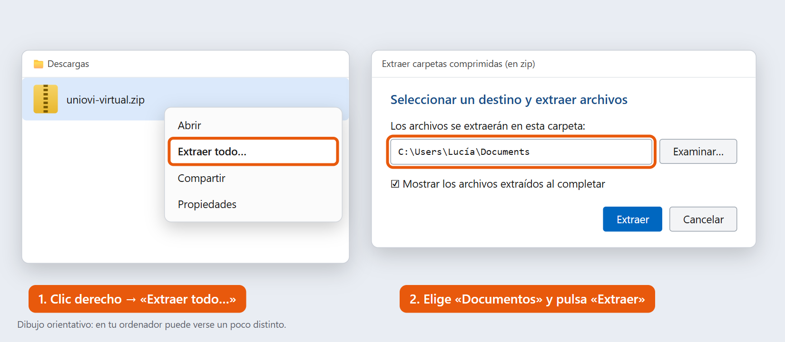
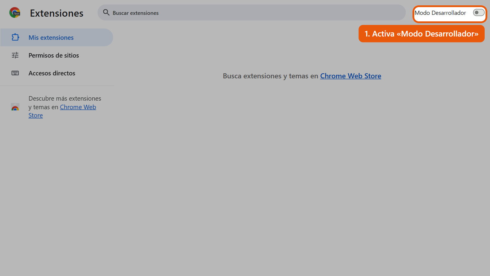
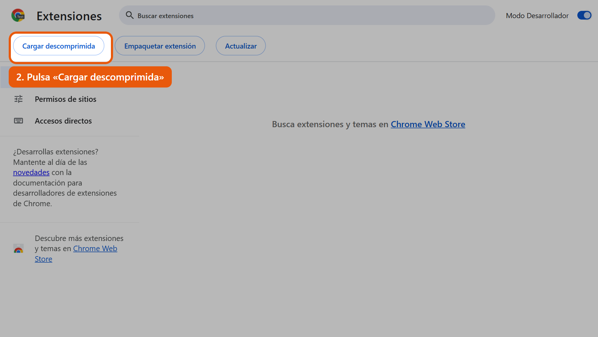
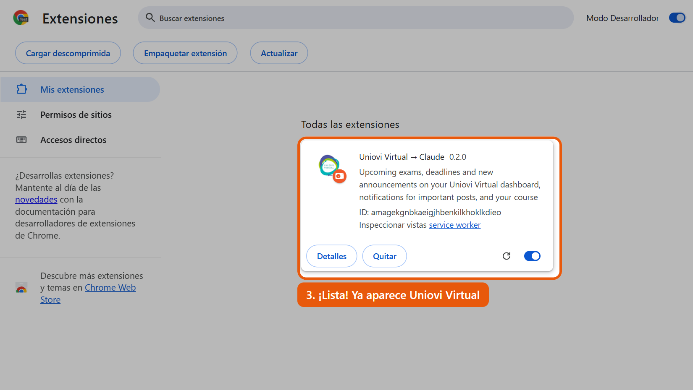
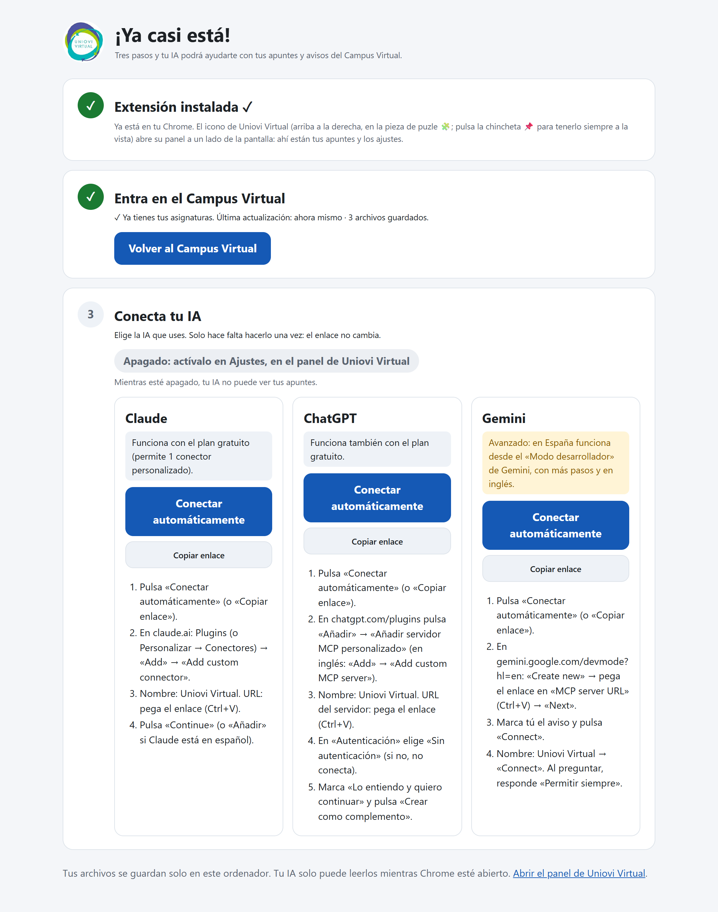
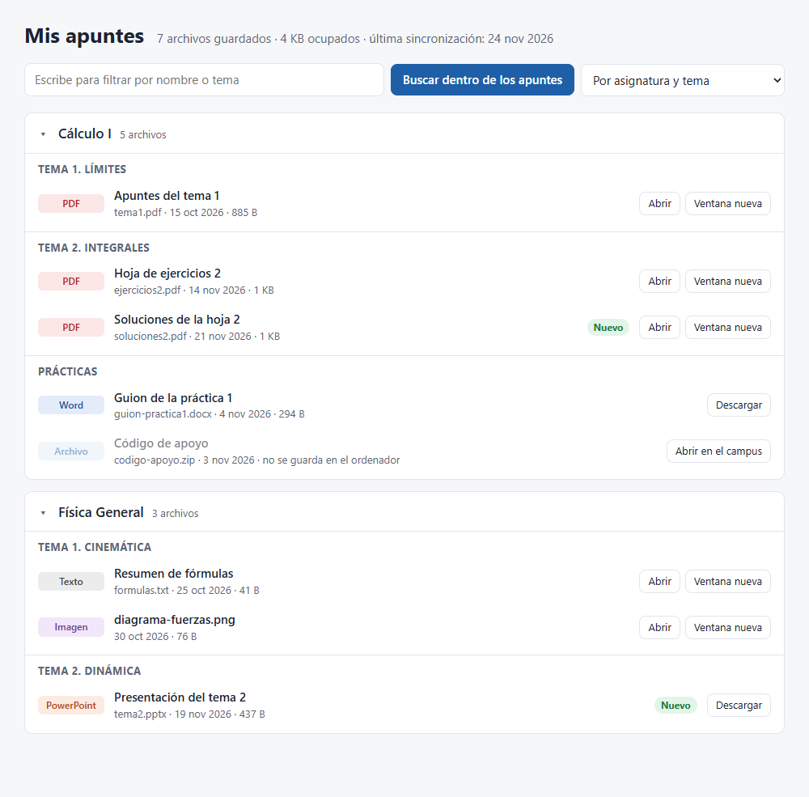
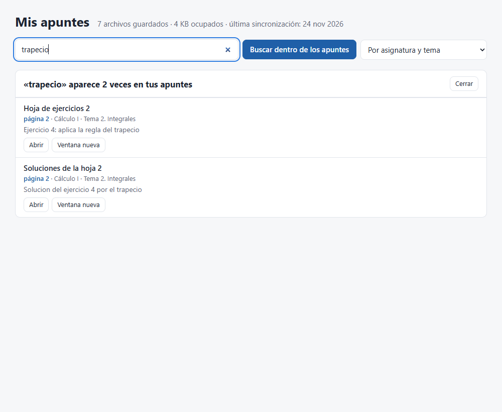
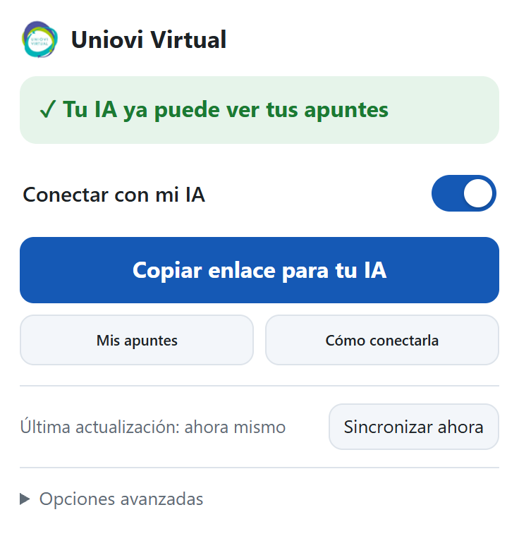
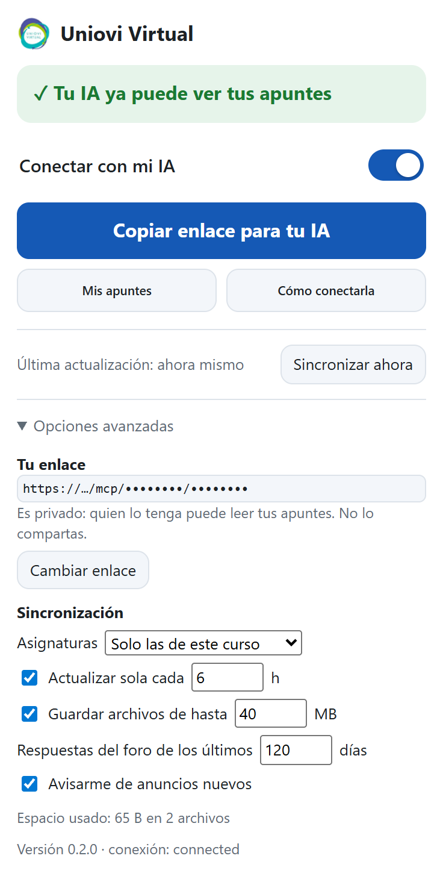

# Uniovi Virtual con tu IA: guía paso a paso

Con esta extensión de Chrome, tu IA (Claude o ChatGPT) puede **consultar tu Campus Virtual**:

- buscar dentro de las diapositivas y PDFs de todas tus asignaturas (y decirte la página);
- ver tus entregas y exámenes ordenados por fecha;
- leer los avisos de los foros y encontrar las fechas de examen que anuncian los profesores.

No hay que instalar ningún programa: **solo la extensión**. Tus archivos se guardan dentro de Chrome, en tu ordenador.

Página de descarga: <https://iyangarcia.github.io/uniovi-virtual-extension/>

---

## 1. Instalar (una vez, 3 minutos)

**Necesitas:** un ordenador con Google Chrome.

### Paso 1. Descarga y descomprime

1. En la página de descarga, pulsa **Descargar**. Se guarda `uniovi-virtual.zip` en tu carpeta **Descargas**.
2. Haz clic derecho en el zip y elige **Extraer todo…**
3. Pulsa **Examinar…**, elige **Documentos** y pulsa **Extraer**.

Ahora tienes la carpeta `Documentos\uniovi-virtual`. **No la borres ni la muevas**: Chrome la usa mientras la extensión esté instalada.

### Paso 2. Modo desarrollador

1. Abre Chrome, escribe `chrome://extensions` en la barra de direcciones y pulsa Intro.
2. Arriba a la derecha, activa **Modo Desarrollador**.

3. Pulsa **Cargar descomprimida**.

### Paso 3. Elige la carpeta

1. Se abre una ventana para elegir una carpeta. Ve a **Documentos**.
2. Haz **un solo clic** en `uniovi-virtual` y pulsa **Seleccionar carpeta**.

Aparece **Uniovi Virtual** en la lista:

Y se abre la **página de bienvenida**, que te guía con lo que falta:

> Consejo: pulsa el icono del puzle 🧩 (arriba a la derecha de Chrome) y luego la chincheta junto a Uniovi Virtual. Así tendrás su botón siempre a mano.

---

## 2. Sincronizar con el campus

1. Entra en el [Campus Virtual](https://campusvirtual.uniovi.es) como siempre, con tu usuario y contraseña.
2. La extensión se pone a copiar tus asignaturas, apuntes, avisos y fechas. La primera vez tarda unos minutos si tienes muchos archivos. **Deja la pestaña del campus abierta** mientras tanto.
3. En la página de bienvenida, el paso «Entra en el Campus Virtual» se marca con ✓ cuando termina.

Después se actualiza sola cada vez que abres el campus (si han pasado unas horas desde la última vez).

La extensión **nunca ve tu contraseña**: usa la sesión que ya tienes abierta en Chrome. Y solo lee: no entrega tareas, no escribe en foros, no cambia nada del campus.

En tu **Área personal** del campus verás además un panel con tus próximos exámenes y entregas, y lo nuevo desde tu última visita.

---

## 3. Conectar tu IA (una vez)

Tu IA se conecta con un **enlace personal** que crea la extensión. Solo hay que pegarlo una vez: el enlace no cambia.

| IA | ¿Funciona? | Qué necesitas |
|---|---|---|
| **Claude** (claude.ai) | Sí, gratis | Una cuenta gratuita. El plan gratis permite 1 conector, justo el que necesitas. **Recomendado.** |
| **ChatGPT** | Sí, de pago | Plan Plus o superior. El plan gratuito no permite añadir conectores. |
| **Gemini** | Probablemente aún no | De momento no parece estar disponible en España. |

### Forma fácil: «Conectar automáticamente»

1. Abre la página de bienvenida (o el botón de la extensión → **Cómo conectarla**).
2. En la tarjeta de tu IA, pulsa **Conectar automáticamente**.
3. Chrome te pide permiso para esa página (claude.ai o chatgpt.com). Pulsa **Permitir**.
4. Se abre la página de conectores de tu IA con el nombre y el enlace **ya escritos**.
5. Revisa y pulsa el botón de confirmar de la propia IA (por ejemplo, **Añadir**).

Si algo no sale bien, la extensión te lo dice y puedes usar la forma manual.

### Forma manual: copiar y pegar

1. Pulsa el botón de la extensión y luego **Copiar enlace**.
2. Pégalo en tu IA como **conector personalizado**:

**Claude (claude.ai)**
1. Menú de tu cuenta → **Personalizar** (*Customize*) → **Conectores** (*Connectors*).
2. **Añadir** → **Añadir conector personalizado** (*Add custom connector*).
3. Nombre: `Uniovi Virtual`. URL: pega el enlace. Pulsa **Añadir**.
4. En un chat nuevo, comprueba que Uniovi Virtual está activado en el menú de herramientas.

En el plan gratuito solo cabe **un** conector personalizado. Si ya tenías otro, tendrás que quitarlo para añadir este.

**ChatGPT (Plus o superior)**
1. Ve a <https://chatgpt.com/plugins> y pulsa **+**.
2. Elige **Añadir servidor MCP personalizado** (*Add custom MCP server*).
3. Nombre: `Uniovi Virtual`. URL: pega el enlace. Sin autenticación (*No authentication*). Guarda.
4. En el chat, elige Uniovi Virtual en el menú **+**.

Los menús de las IAs cambian a menudo. Si no encuentras la opción, busca «conectores» o «MCP» en la ayuda de tu IA.

---

## 4. Qué preguntarle

- «¿Qué exámenes tengo esta semana?»
- «¿Qué entregas y exámenes tengo en las próximas dos semanas?»
- «Prepárame el próximo examen de Derecho Civil: fecha, qué entra, plan de estudio y preguntas de práctica.»
- «Explícame el tema 3 de Derecho Romano con los apuntes de la asignatura y hazme un mini test.»
- «Busca en mis apuntes dónde se explica la usucapión.»
- «¿Ha habido avisos nuevos en los foros esta semana?»

Las fechas que salen de los foros se detectan automáticamente: la IA debería citarte la frase y el enlace al aviso. **Compruébalas siempre en el campus.**

---

## 5. Mis apuntes

Todos los archivos que copió la extensión, ordenados por asignatura y tema, sin salir de Chrome. Ábrelo con el botón de la extensión → **Mis apuntes**.

- Ordena por nombre, fecha o asignatura, y filtra escribiendo en la caja.
- **Buscar en mis apuntes** busca dentro del texto de los PDF y diapositivas.
- Los archivos nuevos desde tu última visita llevan la marca **Nuevo**.
- Al hacer clic, el PDF se abre en una pestaña nueva. Con **Abrir en ventana nueva** puedes poner dos PDF lado a lado (por ejemplo, los ejercicios y sus soluciones).
- Word y PowerPoint no se pueden ver dentro de Chrome: usa **Descargar**.
- Los archivos comprimidos (zip, rar…) no se copian; aparecen con un enlace al campus.

---

## 6. El botón de la extensión

Una frase te dice cómo va todo:

- **✓ Tu IA puede ver tus apuntes**: todo bien.
- **Abre el Campus para sincronizar**: entra en el campus una vez.

Además:

- **Conectar con mi IA**: si lo apagas, tu IA deja de poder leer tus apuntes hasta que lo vuelvas a encender. El panel del campus sigue funcionando.
- **Copiar enlace**, **Mis apuntes** y **Cómo conectarla**.
- En **Opciones avanzadas**, **Cambiar enlace** crea un enlace nuevo y el antiguo deja de funcionar para siempre. Úsalo solo si crees que alguien tiene tu enlace. Después tendrás que pegar el nuevo en tu IA.

---

## 7. Si cierras Chrome

Tu IA **solo** puede leer tus apuntes mientras Chrome está abierto en tu ordenador. No hace falta tener el campus abierto, solo Chrome.

Si Chrome está cerrado (o el ordenador apagado o suspendido), la IA te dirá algo como: «Uniovi Virtual no está conectado: abre Chrome…». Abre Chrome, espera unos segundos y vuelve a preguntar.

Puedes preguntar desde el móvil (en la app de Claude o ChatGPT) siempre que Chrome siga abierto en tu ordenador.

---

## 8. Actualizar

Cuando haya una versión nueva, la extensión te avisará: **«Hay una versión nueva»**. Entonces:

1. En la [página de descarga](https://iyangarcia.github.io/uniovi-virtual-extension/), pulsa **Descargar**.
2. Extrae el zip **en el mismo sitio**: clic derecho → **Extraer todo…** → **Documentos** → **Extraer**. Cuando Windows pregunte, elige **Reemplazar los archivos en el destino**.
3. Abre `chrome://extensions` y pulsa la flecha circular **⟳** en la tarjeta de Uniovi Virtual.

Tus apuntes y tu enlace **se mantienen**: no tienes que volver a conectar la IA.

---

## 9. Tu privacidad

- **Tus archivos se quedan en tu ordenador**, dentro de Chrome. No se suben a ningún sitio.
- **Tus preguntas y las respuestas pasan por el servicio de conexión**, que solo las reenvía entre tu IA y tu Chrome. **No guarda nada.**
- **El enlace es personal, como una contraseña.** Quien lo tenga puede leer tus asignaturas, apuntes y avisos mientras tu Chrome esté abierto. No lo compartas. Si crees que se ha filtrado, usa **Cambiar enlace** (sección 6).
- Lo que tu IA lee (un PDF, una lista de fechas, un aviso…) pasa a tu conversación con esa empresa (Anthropic u OpenAI) y se rige por sus condiciones, como cualquier cosa que le escribas.
- Todo es **de solo lectura**: la IA no puede entregar tareas, escribir en foros ni cambiar nada del campus.

---

## 10. Si algo falla

- **Chrome dice «Falta el archivo de manifiesto» al cargar la carpeta.** Has elegido una carpeta de más o de menos. Elige la carpeta `uniovi-virtual` que tiene dentro `manifest.json`. A veces está dentro de otra carpeta con el mismo nombre: entra en la de fuera y elige la de dentro.
- **No veo «Cargar descomprimida».** Activa **Modo Desarrollador**, arriba a la derecha de `chrome://extensions`.
- **La IA dice que Uniovi Virtual no está conectado.** Abre Chrome. Si ya está abierto, mira que **Conectar con mi IA** esté encendido en el botón de la extensión, y que tengas internet.
- **La IA no encuentra mis apuntes o los datos son viejos.** Entra en el campus y espera a que termine de sincronizar. Puedes pedirle a la IA que mire `sync_status`: te dirá cuándo fue la última sincronización y si hubo avisos.
- **La IA da un error o no responde.** Comprueba que pegaste el enlace completo. Si no funciona, bórralo de tu IA, pulsa **Copiar enlace** otra vez y vuelve a añadirlo.
- **Chrome me avisa de que tengo extensiones en modo desarrollador.** Es normal. Déjala activada.
- **He quitado la extensión sin querer.** Instálala otra vez (sección 1) y entra en el campus: tus apuntes se vuelven a descargar. Tu enlace será nuevo, así que tendrás que conectar tu IA otra vez.
- **Desinstalar.** En `chrome://extensions`, pulsa **Quitar** en la tarjeta de Uniovi Virtual y borra la carpeta `Documentos\uniovi-virtual`. Quita también el conector de tu IA.

---

### Para desarrolladores

`npm install && npm run build`, y carga `extension/dist` en `chrome://extensions`. Para usarlo desde Claude Code (stdio), ver el README. Lista de pruebas manuales: [PRUEBAS-MANUALES.md](PRUEBAS-MANUALES.md).
